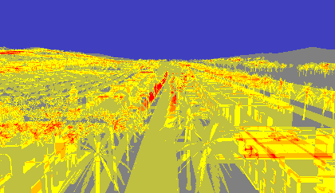
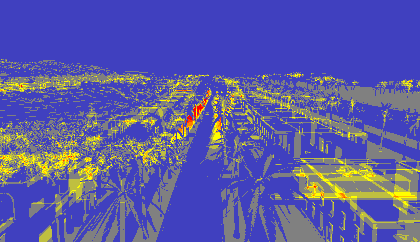

# S4 findings: drawing each frame (GPU)

Search track S4 of the [optimization plan](../../OPTIMIZATION_PLAN.md), 2026-11-21 and 22. Scope: what the GPU spends each frame on at every camera and quality level: the render passes, the shadow map, the effect chain, overdraw, the sky, water and baked-light shaders, resolution per level, and texture memory. No product code changed. Scripts are in [scripts/perf/S4/](../../../../scripts/perf/S4/); raw results in `scripts/perf/results/S4/` (git-ignored) in the worktree that took them (`.claude/worktrees/zaitun-S4`). The baseline is [BASELINE.md](../BASELINE.md).

## The short version

- **At the top quality level, four fifths of the frame is the shadow map and the effect chain, not the scene.** A level-3 frame costs 13.3–14.5 ms on this Mac. Ambient occlusion is 4.1–4.4 ms of it, the shadow map 2.9–3.1 ms, depth of field 2.2–2.6 ms, bloom 0.9–1.2 ms. Hiding every building saves 0.5–1.4 ms.
- **The ambient-occlusion pass draws the scene twice more each frame, and each time the 4096² shadow map is redrawn too** (three shadow passes a frame). That costs 1.5–1.7 ms and changes nothing you can see (S4-1).
- **The shadow map's cost is its size, not its triangles.** At 2048² it saves 1.1–1.3 ms and 96 MB of GPU memory, within the look gate (S4-2). Drawing it only when needed would save 2.4–2.5 ms, but not the simple way: a frozen map misses the buildings that were out of view when it was drawn (S4-3).
- **Depth of field runs its 11 passes with the blur at zero** in the explorer and at the last tour stop: 2.2 ms for no effect (S4-4).
- **The last step up doubles the frame**: level 2 is 6.5–7.5 ms, level 3 is 13.4–14.5 ms. Ambient occlusion alone accounts for 5.1 ms of the step and moves the picture by 1.0–1.6/255 (S4-5, S4-6).
- **The draw order shades 2.2–2.7 screens of opaque pixels to show one**, on both tiers: the sky is drawn first, the land second, the buildings last. Drawing sky, land and water last cuts that to 1.2–1.6 with an identical picture. It is nearly free on this Mac's GPU, which discards hidden pixels by itself; most Android phones do not (S4-7).
- **The low tier cannot be ranked on this Mac.** Its frame is 1.3–1.8 ms here and every knock-out is inside the noise. What carries over to a phone are counts: 20 passes a frame, 2.2–2.6 screens of opaque shading, up to 1.8 more screens of light shafts, 16 bloom passes (S4-7 to S4-9). The real-phone session has to time them.

## How it was measured

Everything ran through the P0 rig (it holds the measurement lock) on the production build of `main` at 09684f0, on the baseline's machine (Apple M3 Pro, ANGLE on Metal, headless Chrome 157), on the charger. High tier = desktop profile (1440 × 900 at 2×); low tier = phone profile (412 × 915), **without** the 4× CPU slowdown, because this track is about the GPU's share. Each run is a fresh load of Home at one of the rig's fixed cameras. S4's probe ([probe.js](../../../../scripts/perf/S4/probe.js)) is installed after the rig's.

| What | How |
|---|---|
| **Frame time** | After a frame is drawn, one pixel is read back, which waits until the GPU has finished. The time from the start of the frame callback to that point is the frame's cost in real milliseconds, JavaScript and GPU one after the other |
| **Back to back** | While timing, six frames are drawn per tick. At one frame per 60 Hz tick the GPU idles between frames and its governor clocks it down, so a lighter frame does not get proportionally faster (see the rig notes) |
| **Knock-outs** | One change to the live scene (hide a layer, skip a family of passes, resize or freeze the shadow map, change the draw order). Its cost is read as a **pair in one page load**: the shipped frame for 40 ticks, the change, 12 ticks to settle, the changed frame for 40 ticks. Two loads per change; "nothing changed" timed the same way gives the noise (±0.1–0.3 ms on the high tier) |
| **Passes** | Every `render()` call labelled by what it draws and where to, with a read-back after each. The read-back itself costs about 0.3 ms a pass (the smallest pass, a 10 × 6 pixel blur, is all read-back), which is taken off every pass. Read these for shares; the knock-outs are the reference for milliseconds |
| **Overdraw** | Every material is swapped for a copy that keeps its vertex stage, cut-out, depth settings and place in the draw order, and adds one to the frame buffer. Counted per material: fragments that pass the depth test in the real draw order ("shaded"), how many end up in the picture ("visible"), in screens (fragments ÷ pixels). Lines and sprites are left out |
| **Texture memory** | Every texture and renderbuffer allocation in the WebGL context, by format and size |
| **First frame** | Every WebGL call of the first frames timed by kind, in a fresh browser each time |
| **Look** | Each candidate captured under virtual time at six cameras and compared with the shipped scene captured the same way in the same run. Given twice: every pixel, and 4 × 4 block averages, which cancel the film grain (as S3 does). The same scene captured twice differs by 0.000/255 at all twelve camera and tier pairs |

Limits to keep in mind:

- **The GPU is this Mac's**, which discards hidden opaque pixels before shading them (tile-based deferred rendering). Fill-rate waste that costs nothing here can cost a lot on a phone. Fragment counts are given so those cases still have a number.
- **Frame times are with the GPU kept busy**, so they are what the machine can do, not what it does at 60 Hz with time to spare. A frame holds 60 fps if this number is under 16.7 ms.
- **A skipped pass leaves stale buffers behind it**: "passes not drawn" rows measure a cost, they are not a fix. Candidate fixes are marked and have a look number.
- **One change per measurement.** Sums of rows below are sums of parts, not measured together.

## Summary

| ID | Finding | Evidence | Proposed fix | Gain against | Look | Effort | Fix track |
|---|---|---|---|---|---|---|---|
| **S4-1** | The ambient-occlusion pass redraws the scene twice a frame (transparent objects only) and each redraw redraws the whole 4096² shadow map | 3 shadow passes and 3 scene passes per level-3 frame; not drawing the two extra ones saves **1.5–1.7 ms (10–13%)** by day, 0.0 at dusk (no shadow map) | Turn off n8ao's transparency detection (`autoDetectTransparency`), or draw the shadow map once per frame at most | Desktop frame time, level 3; 56 MB of GPU memory | 0.00–0.07/255 at six cameras | small | F3 (`PostFX.tsx`) |
| **S4-2** | The shadow map is 4096² and carries a colour texture nothing reads: 128 MB, cleared and written every pass | Shadows cost **2.9–3.1 ms (21–22%)**; 2048² saves **1.1–1.3 ms (9%)** and 96 MB; hiding all buildings (1.2 M shadow triangles) saves less than that | 2048² (and a frustum fitted to the site, 860 × 326 m, instead of 660 × 660 m) | Desktop frame time, memory | ≤ 0.69/255 (0.60 grain-free), shadow edges soften at tour stop 1: owner's glance | small | F3 (`world.ts`) |
| **S4-3** | The shadow map is redrawn every frame although buildings and plants do not move | Not redrawing it saves **2.4–2.5 ms (18%)**; a plain freeze **fails the look (2.55/255)** because casters are culled to the camera's view | Draw it once from a caster set that does not depend on the view; redraw for people and cars at a lower rate or give them blob shadows | Desktop frame time | gated: plain freeze fails | medium | F3, with `instanceCulling.ts` (F2B) and `SceneLife.tsx` (F4) |
| **S4-4** | Depth of field runs its 11 passes while the blur is 0: the whole explorer (orbit, walk, aerial) and the last tour stop | **2.2 ms (16%)** at the explorer's aerial, 2.6–2.8 ms at the stops | Leave the effect out while `rig.blur` is 0 | Desktop frame time, levels 2 and 3 | none expected at blur 0 (F3 to confirm on the reference frames) | small | F3 (`PostFX.tsx`) |
| **S4-5** | Ambient occlusion is the largest single cost and adds little: the baked lightmap already holds the occlusion | Level 3's chain against level 2's at the same pixel ratio: **5.1 ms (35–38%)**; the picture moves by 1.0–1.6/255 grain-free | Owner's call: keep it (with S4-1), run it only where it shows (close stops), or drop it | Desktop frame time | 1.35–2.12/255 raw, over the gate at stop 1 | small | F3 (`quality.ts`, `PostFX.tsx`); decision at T |
| **S4-6** | The step from level 2 to level 3 doubles the frame, and the monitor takes it as soon as level 2 holds 57 fps | Level 1 **3.4–4.7 ms**, level 2 **6.5–7.5 ms**, level 3 **13.4–14.5 ms**; pixels alone (1.5× to 1.75×) are +2.0 ms of the step | Even out the steps (occlusion and the higher ratio as separate levels, or neither) | Frame rate held on desktops slower than this one; fewer level flip-flops (S5) | per level | small | F3 (`quality.ts`), thresholds with S9 |
| **S4-7** | Opaque objects are drawn in the order their materials were made: sky, land, water, people, plants, buildings last | **2.2–2.7 screens shaded for 1.0 visible** (both tiers); sky, land and water last: **1.2–1.6**. On this Mac 1.0 ms at tour stop 1, 0–0.2 ms elsewhere | `renderOrder` on the sky, the land and the water | Phone frame rate (not measurable here); desktop up to 6% | **0.00–0.01/255**, identical | trivial | F3 (`SceneWorld.tsx`, `world.ts`) |
| **S4-8** | Light shafts cover the screen up to 1.8 times with blended pixels, most of them carrying no light | Tour stop 3: **1.64 (high) and 1.77 (low) screens**; stop 2: 0.9–1.1; stop 4: 0.5–0.6; walk: 0.4. On this Mac 0.2 ms | Shorter, narrower quads where the light is; drop shafts facing away in code; off on the low tier | Phone frame rate at level 1 | gated | small | F3 (`godrays.ts`, `quality.ts`) |
| **S4-9** | Bloom is 16 passes at every level, phones included; on a phone the last four levels are under 20 px wide | 0.9–1.2 ms (7–11%) on the high tier; 16 of the low tier's 18–20 passes | Fewer blur levels on the low tier (5 instead of 8) | Passes per frame on phones (10 instead of 16) | gated | small | F3 (`PostFX.tsx`) |
| **S4-10** | Level 3 ends with an extra full-screen copy: the last effect pass draws into a buffer and a copy pass puts it on screen | 0.4 ms (pass timing); levels 1 and 2 draw the last pass straight to the screen | Order the chain so the last pass draws to the screen | Desktop frame time, level 3 | none | small | F3 (`PostFX.tsx`) |
| **S4-11** | Level 3 holds 573 MB of textures for a 1440 × 900 window: 17 full-size render targets and the shadow map | 231 / 333 / 573 MB at levels 1 / 2 / 3 (587 MB at dusk); low tier 19–36 MB | S4-1 and S4-2 free 56 and 96 MB, S4-4 roughly 70 MB while the blur is 0; the rest follows the pixel ratio | Memory; context loss on integrated GPUs | none | – | F3 |
| **S4-12** | Baked surfaces look the sun's shadow up twice (three's own lookup, then `bakedLight.ts`): 10 filtered taps instead of 5 | Dropping the second: 0.5 ms at tour stop 1, 0.0–0.1 ms elsewhere | Reuse the value three already has | Desktop frame time (small) | none if reused (the knock-out, which drops it, moves 0.32/255) | small | F2B (`bakedLight.ts`) |
| **S4-13** | The long first frame is shader programs, all inside the scene pass | First frame 267–278 ms (high), 166–173 ms (low); **197–205 and 121–126 ms** of it inside `getProgramInfoLog` for 45 and 26 programs; textures 2 ms, buffers 3 ms | S1-1 (compile ahead); nothing to add | P7 attributed | – | – | F1 / F3 as S1-1 says |

**Together** (sums of parts, not measured together): S4-1, S4-2 and S4-10 take a level-3 frame from about 14 ms to 11–11.5 ms at the tour stops (S4-1 and S4-2 both cut shadow-pass work, so together they give somewhat less than their sum), and S4-4 takes the explorer to about 9 ms, with no change to the look beyond S4-2's softer shadow edges. S4-3 would take about another 1.3 ms once S4-2 is in.

## Where a level-3 frame goes

### Knock-outs (high tier, level 3, 2520 × 1456)

What each change saves per frame, in ms and as a share of the shipped frame (first row). `~` marks a difference inside the noise. Two page loads each; the two differed by 0.08 ms at the median and by under 0.3 ms nine times in ten (the one pair that disagreed by 2 ms, water at tour stop 1, is marked `~`).

| Change | Tour stop 1 (entrance) | Tour stop 3 (villa) | Aerial (explorer) | Dusk (boulevard) |
|---|---|---|---|---|
| **The shipped frame** | **14.3 ms** | **13.3 ms** | **14.2 ms** | **11.1 ms** |
| No sun shadow at all | 3.1 (22%) | 2.9 (21%) | 2.9 (21%) | (none at dusk) |
| Shadow map kept, not redrawn | 2.5 (18%) | 2.4 (18%) | 2.5 (18%) | |
| Shadow map 2048² | 1.3 (9%) | 1.1 (9%) | 1.3 (9%) | |
| Shadow map 1024² | 1.6 (11%) | 1.5 (12%) | 1.7 (12%) | |
| One shadow lookup on baked surfaces | 0.5 (4%) | 0.1 (1%) | ~0.0 | |
| Ambient occlusion passes not drawn | 4.4 (30%) | 4.2 (32%) | 4.1 (29%) | 2.5 (23%) |
| … only its two extra scene renders | 1.5 (10%) | 1.7 (13%) | 1.7 (12%) | ~0.0 |
| Level 2's chain at level 3's pixels (no occlusion, no extra copy) | 5.1 (35%) | 5.1 (38%) | | |
| Depth of field passes not drawn | 2.6 (18%) | 2.6 (19%) | 2.2 (16%) | 2.8 (25%) |
| Bloom passes not drawn | 1.0 (7%) | 0.9 (7%) | 1.2 (9%) | 1.2 (11%) |
| SMAA edge and weight passes not drawn | 0.4 (3%) | 0.5 (3%) | 0.7 (5%) | 0.5 (4%) |
| Buildings hidden (2.67 M → 0.36 M triangles at stop 1) | 1.4 (9%) | 0.5 (4%) | 1.3 (9%) | 0.9 (8%) |
| Plants hidden | 0.5 (4%) | 0.2 (1%) | 0.4 (3%) | 0.4 (4%) |
| Land hidden | 0.4 (3%) | 0.3 (2%) | 0.9 (6%) | |
| Water hidden | ~0.7 | 0.2 (2%) | ~0.0 | |
| Sky hidden | ~−0.1 | ~0.0 | ~0.0 | |
| People, cars and birds hidden (485 → 181 draw calls at stop 1) | ~0.1 | ~0.0 | ~−0.1 | |
| Light shafts hidden | ~0.1 | 0.2 (2%) | ~0.0 | |
| Every surface one flat colour (no lighting, textures, fog) | 2.2 (15%) | 1.3 (10%) | 1.8 (13%) | 1.2 (11%) |
| No sky light on surfaces (`scene.environment`) | 0.5 (3%) | 0.3 (2%) | 0.4 (2%) | |
| Sky drawn last | 0.2 (1%) | ~−0.1 | ~0.0 | |
| Sky, land and water drawn last | 1.0 (6%) | 0.2 (2%) | ~0.2 | |

What this says:

- **Shadows, occlusion, depth of field and bloom together are about 10.5 ms of a 13.3–14.3 ms frame by day.** Everything the visitor would call "the scene" is the rest.
- **Triangles are not what limits this GPU.** Hiding the buildings removes 87% of the triangles drawn at tour stop 1 and saves 9%. The 300k target still matters for phones' vertex work and for download size (F2B); it will not buy desktop frame rate.
- **All surface shading is 10–15%.** Lighting, the baked light, textures and fog for every pixel cost 1.3–2.2 ms; shader simplification has little to give on desktop.
- **People and cars cost the GPU nothing measurable**; their 300 draw calls are a JavaScript cost (S5).

### Passes

The 43 render passes of one level-3 frame at tour stop 1 (read-back floor of 0.30 ms taken off each):

| Passes | What | Target | ms |
|---|---|---|---|
| 1 | The scene | 2520 × 1456, half float | 6.5 |
| (inside it) | Shadow map | 4096² | 2.1 |
| 2–5 | n8ao: clear and depth copy, **scene again** (transparent objects, depth write off), clear and copy, **scene again** (depth write on) | full size, half float | 1.8 |
| (inside them) | **Shadow map, twice more** | 4096² | 1.1 |
| 6–12 | n8ao: occlusion at half size, depth, two denoise passes, upsample to full size (1.1 ms), copy | half and full size | 3.0 |
| 13–14 | SMAA edges and weights | full size, 8-bit | 0.8 |
| 15–25 | Depth of field: circle of confusion, four blurs and a copy at half size, mask, four bokeh passes | half and full size | 3.3 |
| 26–41 | Bloom: luminance at full size, 8 down, 7 up | full size down to 10 × 6 | 1.2 |
| 42 | All effects merged (bloom, tone mapping, SMAA blend, vignette, grain) | full size, half float | 1.0 |
| 43 | Copy to the screen | screen | 0.4 |

Shares of the frame by family at every camera (same floor taken off; shares are what to read here):

| Camera | Scene | Shadow map | Ambient occlusion | Depth of field | Bloom | SMAA | Merged effects | Final copy |
|---|---|---|---|---|---|---|---|---|
| opening | 29% | 16% | 24% | 13% | 7% | 4% | 5% | 2% |
| stop 1 | 31% | 15% | 23% | 16% | 6% | 4% | 5% | 2% |
| stop 2 | 28% | 16% | 24% | 17% | 6% | 3% | 4% | 2% |
| stop 3 | 21% | 15% | 29% | 18% | 6% | 4% | 5% | 2% |
| stop 4 | 19% | 17% | 26% | 18% | 7% | 4% | 6% | 2% |
| stop 5 | 24% | 16% | 26% | 15% | 7% | 4% | 6% | 2% |
| aerial | 25% | 16% | 27% | 14% | 6% | 4% | 6% | 2% |
| orbit | 27% | 17% | 26% | 13% | 6% | 4% | 5% | 2% |
| walk | 21% | 18% | 27% | 15% | 7% | 4% | 6% | 2% |
| dusk | 26% | 0% | 30% | 22% | 8% | 4% | 7% | 3% |

The frame is the same shape at every camera: the opening is not a special case (K7). At level 1 (20 passes) the scene is 47–57% and the shadow map 22–25%; at level 2 (31 passes) depth of field is 19–27%. On the low tier (18–20 passes, no shadow map) the scene is 59–83%, bloom 12–21%, SMAA 12–16%.

### Levels and pixel ratios

Each cell is paired with the tier's best level in one page load.

| High tier | Buffer | Passes | Stop 1 | Stop 3 |
|---|---|---|---|---|
| Level 1 at its 1.25× | 1800 × 1040 (1.9 MP) | 20 | **4.7 ms** | **3.4 ms** |
| Level 2 at its 1.5× | 2160 × 1248 (2.7 MP) | 31 | **7.5 ms** | **6.5 ms** |
| Level 3 at its 1.75× | 2520 × 1456 (3.7 MP) | 43 | **14.5 ms** | **13.4 ms** |
| Level 1's chain at 1.75× | 2520 × 1456 | 20 | 6.6 | 5.3 |
| Level 2's chain at 1.75× | 2520 × 1456 | 31 | 9.5 | 8.2 |
| Level 3's chain at 1× | 1440 × 832 (1.2 MP) | 43 | 7.1 | 6.1 |
| Level 3's chain at 1.25× | 1800 × 1040 | 43 | 9.3 | 8.2 |
| Level 3's chain at 1.5× | 2160 × 1248 | 43 | 11.6 | 10.5 |
| Level 3's chain at 2× | 2880 × 1664 (4.8 MP) | 43 | 17.9 | 16.6 |

- Level 3's chain costs about **3.0 ms per megapixel plus 3.5 ms** that does not depend on resolution (the shadow passes, geometry, JavaScript).
- At the same pixels, depth of field adds 2.9 ms (level 1's chain to level 2's) and ambient occlusion with its extra copy 5.0–5.1 ms (level 2's to level 3's).
- Level 3 holds 60 fps here with 2–3 ms to spare and cannot hold a 120 Hz display (8.3 ms); level 2 can, just.
- Low tier: level 0 is 1.3–1.6 ms and level 1 1.3–1.8 ms here, with differences inside the noise. Not a phone number.

## The findings

### S4-1. Ambient occlusion redraws the scene, and the shadow map with it

n8ao looks for transparent materials in the scene (`detectTransparency`, on by default). It finds the light shafts and the clear glass, switches itself to "transparency aware", and from then on, every frame, hides everything else, draws the scene's transparent objects into two extra full-size half-float targets (once for materials that write depth, once for those that do not), and restores visibility. Each of those is a normal `renderer.render(scene, camera)`, so three redraws the sun's shadow map each time: a 4096² clear and store for a handful of casters, and the map it leaves behind is wrong until the next frame's first pass redraws it.

Measured: the two extra scene renders and their shadow passes cost 1.5–1.7 ms by day (10–13% of the frame) and nothing at dusk, when the sun casts no shadow. Not drawing them changes the picture by 0.00–0.07/255 across six cameras (the worst is the explorer's aerial, where markers are transparent). They also walk the scene graph four times a frame and build a map of every object (S5's garbage). The two targets are 56 MB.

Fix: set `autoDetectTransparency = false` on the pass (setting `transparencyAware={false}` is not enough: the option only takes effect when its value changes), or keep it and make the shadow map draw once per frame (S4-3 does that as a side effect).

### S4-2. The shadow map: 128 MB, and its size is the cost

three's shadow render target is a 4096² RGBA8 colour texture (64 MB, never read) plus the 4096² depth texture (64 MB). Every shadow pass clears and stores both.

- No shadows at all: 2.9–3.1 ms (21–22%).
- Not redrawn (lookups stay): 2.4–2.5 ms. So the passes are four fifths of the cost and the lookups one fifth.
- 2048²: saves 1.1–1.3 ms. 1024²: 1.5–1.7 ms.
- All buildings hidden (1.2 M of the 1.2 M shadow triangles, and 1.1 M scene triangles): 0.5–1.4 ms in all.

Look at 2048²: 0.00–0.10/255 at five cameras and 0.69/255 (0.60 grain-free) at tour stop 1, where 0.7% of 4 × 4 blocks move by more than 16: long shadow edges across the entrance soften. At 1024² it is 1.19/255 with 2.1% of blocks moved, for 0.3 ms more. The map covers 660 × 660 m (0.16 m per texel) for a site of 860 × 326 m: a frustum fitted to the plan, turned to the sun's heading, would give 2048² about the same texel size inside the walls as 4096² has now.

### S4-3. Shadow map on demand: worth 2.4 ms, but not by freezing it

The ledger's K6 proposes "update only when something moves" as a small, low-risk fix. The gain is confirmed (2.4–2.5 ms, 18%), the risk is not. Frozen on the twelfth frame, the map fails the gate at tour stop 1 (2.55/255, 8.6% of blocks moved; 0.6–0.8/255 at the opening and stop 3). The reason is that the casters depend on the camera: `InstanceCulling` draws only the building copies within 60 m of the view, and `SceneVegetation` only the plants in the view cone, at the level their distance asks for. A map drawn from one camera lacks the shadows another camera needs.

A working version draws the map once from a caster set that does not depend on the view (every building copy and every plant inside the shadow box, at one fixed level), then leaves it. That is 1.2 M triangles once instead of every frame. What still moves is people and cars (their shadows could be a second small map, a redraw every few frames, or blobs) and nothing else: the plants' shadows already stand still, because the wind is applied in the colour pass only. Effort is medium, and it crosses files of three tracks (`world.ts` and `SceneWorld.tsx` are F3's, `instanceCulling.ts` F2B's, `SceneLife.tsx` F4's).

### S4-4. Depth of field with nothing to blur

The effect follows `rig.blur`. The story sets it to 0.25–0.7 at the opening and tour stops 1–4 and to 0 for the last stop's climb and aerial; the explorer sets 0 in every mode (`StoryRig.tsx` lines 313, 379, 387). At 0 the effect still runs all 11 passes (circle of confusion, four blurs, a copy, the mask, four bokeh passes) and holds its render targets. Measured at the explorer's aerial: 2.2 ms (16%). The explorer is where visitors spend open-ended time, and at level 2 depth of field is the largest post effect (19–27% of the frame).

### S4-5 and S4-6. What level 3 buys, and the size of its step

Level 3 adds ambient occlusion and 36% more pixels to level 2 and costs twice as much (6.5–7.5 ms to 13.4–14.5 ms). At equal pixels the occlusion chain is 5.1 ms. What it changes in the picture, measured as level 2's chain against level 3's at the same resolution: 0.98–1.64/255 with the grain cancelled, 1.35–2.12/255 raw (over the gate at tour stop 1), with 0.0–1.6% of blocks moving by more than 16. The model's surfaces already carry baked occlusion in the lightmap, so the screen-space pass mostly darkens contact lines on plants, people and the ground.

The monitor moves a desktop up a level when it holds more than 57 fps at 60 Hz. A machine on which level 2 takes 12 ms holds 60, is moved to level 3, where the frame takes about 25 ms, falls under 48 fps and is moved back: the flip-flop S5 saw as hitches. Three options for T and the owner: keep occlusion and make the step smaller (occlusion at 1.5×, the higher ratio as its own level); run occlusion only at the close stops; or drop it and let level 3 be level 2 at 1.75× (9.5 ms at stop 1).

### S4-7. Draw order: 2.2–2.7 screens shaded for one

three sorts opaque objects by `renderOrder`, then by **material id**, and only then by depth. Material ids follow creation order, so the scene is drawn in the order its parts are mounted: the sky dome (render order −1, every pixel of the screen), the land, the water, people and cars, plants, and the buildings last. Each of those is shaded where it passes the depth test at that moment, and most of it is then covered.

| Camera | Shaded (shipped order) | Sky last | Sky, land and water last | Visible |
|---|---|---|---|---|
| opening | 2.24 / 2.18 | 1.51 / 1.48 | 1.58 / 1.52 | 1.00 |
| stop 1 | 2.71 / 2.49 | 1.98 / 1.80 | 1.42 / 1.27 | 1.00 |
| stop 3 | 2.52 / 2.45 | 1.73 / 1.66 | 1.29 / 1.23 | 1.00 |
| aerial | 2.35 / 2.31 | 1.46 / 1.39 | 1.20 / 1.19 | 1.00 |
| walk | 2.35 / 2.25 | 1.74 / 1.65 | 1.24 / 1.24 | 1.00 |
| stop 2, 4, 5, dusk (shipped only) | 2.50–2.59 / 2.28–2.49 | | | 1.00 |

Screens of opaque fragments, high tier / low tier. By material at tour stop 1 (high): the sky shades 1.00 screen and shows 0.28; the land shades 0.74 and shows 0.10; everything else wastes 0.36 between them.




(Blue is one layer, grey two, yellow three to four, red eight or more. The red strip down the middle is the avenue's palms seen end on.)

On this Mac the reorder is worth 1.0 ms at tour stop 1 and 0–0.2 ms elsewhere, because Apple's GPU works out which opaque pixel is visible before shading any. Most Android GPUs reject a hidden pixel reliably only when what hides it was drawn first, so there the shipped order runs the land's lit, fogged shader on up to three quarters of the screen and the sky's on all of it before the buildings arrive. That expectation needs the real-phone session to put a frame time on it; the fragment counts do not. The picture is identical either way: 0.000/255 with the sky last at all twelve camera and tier pairs, 0.00–0.01/255 with land and water last too (single pixels on depth ties). Three `renderOrder` values.

### S4-8. Light shafts

The shafts are 35 additive quads, 52–64 m long and 3–3.4 m wide, placed in the shader; the fragment shader fades each one to nothing along most of its length and whenever the camera is not looking toward the sun, but the quad is still rasterized, blended and its shader run. At tour stop 3 they cover the screen 1.64 times on the high tier and 1.77 on the low, at stop 2 0.9–1.1, at stop 4 0.5–0.6, while walking 0.4. They are on at low-tier level 1 (`quality.ts`), which is where a phone that copes ends up. Here they cost 0.2 ms at stop 3; on a phone limited by fill rate, 1.8 screens of blending is more than the whole opaque scene needs once S4-7 is in.

### S4-9. Bloom on a phone

`mipmapBlur` runs a luminance pass at full size and 8 levels down and 7 up: 16 passes at every level, on both tiers. On the low tier at level 1 the levels are 258 × 529, 129 × 265, 65 × 133, 33 × 67, 17 × 34, 9 × 17, 5 × 9 and 3 × 5 pixels; the last four are under 20 px wide. Each pass is a render-target switch, which on a tile-based phone GPU has a fixed cost that the area of the target does not reduce. On this Mac bloom is 0.9–1.2 ms on the high tier and not measurable on the low.

### S4-10. The extra copy at level 3

At levels 1 and 2 the merged effect pass draws straight to the screen. At level 3, with n8ao's pass ahead of it, the merged pass draws into a full-size half-float buffer and a separate copy pass moves it to the screen: 0.4 ms and one more full-size pass.

### S4-11. Texture memory

For a 1440 × 900 window (estimated from the context's allocation calls):

| Tier and level | Buffer | All textures | Shadow map | Full-size targets | Smaller targets | Model and lightmap textures |
|---|---|---|---|---|---|---|
| high, level 1 | 1800 × 1040 | 231 MB | 128 MB | 64 MB in 7 | 10 MB | 24 MB |
| high, level 2 | 2160 × 1248 | 333 MB | 128 MB | 144 MB in 10 | 32 MB | 24 MB |
| high, level 3 | 2520 × 1456 | 573 MB | 128 MB | 350 MB in 17 | 66 MB | 24 MB |
| low, level 0 | 412 × 847 | 19 MB | – | 7 MB in 3 | 2 MB | 6 MB |
| low, level 1 | 515 × 1058 | 32 MB | – | 19 MB in 7 | 3 MB | 6 MB |

Dusk adds 14 MB (the dusk lightmap pages). At level 3 the eight full-size half-float targets alone are 224 MB. Everything but the shadow map and the model's textures scales with the window: a 2560 × 1440 window at 1.75× would hold about 1.4 GB at level 3 (computed, not measured). The model's own textures, compressed, are 24 MB: the render targets are 20 times that.

### S4-12. Two shadow lookups on baked surfaces

three's PCF filter takes five hardware-filtered taps with a per-pixel rotation. Every baked material runs it twice: once in three's own light loop and once in `bakedLight.ts`, which asks for the same shadow value again to take the baked sun out where a plant or a person shades the surface. Dropping the second lookup saves 0.5 ms at tour stop 1 and 0.0–0.1 ms elsewhere. The fix is to reuse the value three computed, which changes nothing in the picture.

### S4-13. The first frame

Three fresh browsers per tier: the first frame takes 267–278 ms to GPU-done on the high tier and 166–173 ms on the low. Of that, 197–205 ms and 121–126 ms are inside `getProgramInfoLog` (45 and 26 programs), all of it in the scene pass (225–235 ms); the effect passes take 1–4 ms each, texture calls 2 ms, buffer uploads 3 ms. The second frame is 18–19 ms and 5–7 ms. This is S1's finding seen from the GPU side (these are the cached-shader numbers; S1 measured the first-ever visit). P7 is the same stall; nothing to add to S1-1.

## Ruled out (no gain worth a fix)

| Candidate | Measured | Why not |
|---|---|---|
| Fewer triangles for desktop frame rate | Hiding all buildings: 0.5–1.4 ms (4–9%) | This GPU is not vertex-bound; do it for phones and bytes (F2B), not for this |
| The sky shader | Hidden: 0.0 ms | Covered pixels are free here; S4-7 handles phones |
| The water shader | Hidden: 0.0–0.2 ms (0.7 inside the noise at stop 1) | Small |
| People, cars and birds on the GPU | Hidden: 0.0 ms | Their cost is draw calls in JavaScript (S5) |
| Plants | Hidden: 0.2–0.5 ms | Small on desktop; cut-out leaves and cards waste at most 0.12 screens per material |
| Sky light on surfaces (`scene.environment` at 0.08) | Off: 0.3–0.5 ms (2–3%); picture 0.5–1.3/255 darker | Not worth a look change on desktop; revisit for phones with a real device |
| Shadow map 1024² | 0.3 ms more than 2048² | Twice the look change of 2048² |
| SMAA | 0.4–0.7 ms | The only antialiasing the picture has |
| Sky drawn last, on this Mac | 0.0–0.2 ms | Free and identical, so still do it (S4-7); just not a desktop gain |

## Corrections to the ledger

- **K6** (shadow map redrawn each frame): the cost is 2.9–3.1 ms, the map is drawn up to three times a frame at level 3 (S4-1), its size matters more than its triangles (S4-2), and "update only when something moves" is medium effort with a look gate, not small and low-risk (S4-3).
- **K7** (the opening is the slowest desktop moment): at level 3 every camera is within 13.3–14.5 ms and the same shape; the weight is level 3's chain, not the opening shot.
- **K4** (no distance levels, 1.4 M triangles): confirmed as a count, but triangles cost this GPU under a tenth of the frame. The gain is for phones.
- **P7** (one long frame when the scene appears): attributed, S4-13 and S1-1.
- **Baseline, "60 held at every camera"**: true, with 2–3 ms to spare at level 3 once the GPU runs at full clock.

## Notes on the rig (for P0's owner and T)

1. **Frame timing at one frame per 60 Hz tick misleads.** The same frame (tour stop 1, level 3) reads 17.0–18.0 ms paced at 60 Hz and 14.0–15.1 ms drawn back to back, and paced knock-outs came out too small and inconsistent (the same change saved 1.15 ms at one camera and cost 0.75 ms at another). The baseline's relative GPU timer is paced the same way. Fix tracks that need a frame time should use back-to-back frames (`scripts/perf/S4/probe.js`, `repeat`).
2. **The same frame drifts by up to 2.5 ms between page loads** while other sessions work on the machine (14.4 against 16.9 ms, minutes apart, each tight within its run). Before and after belong in one page load.
3. **`gl.finish()` returns at once in Chrome.** A one-pixel `readPixels` is what waits for the GPU.
4. **The stored reference frames differ from a fresh capture of the same build by 0.33–1.04/255** (0.11–0.34 with the grain cancelled). It is the film grain's phase: the rig pins the level with a 100 ms real-time wait, so the frame on which the effect chain is rebuilt varies. With the pin on fixed frames, twelve of twelve captures repeat at 0.000/255. Until then, look numbers under about 1/255 against the stored references include this.
5. **`rig.mjs` fails in a worktree without `node_modules`** (`machineInfo` reads `node_modules/next/package.json` from the checkout). Worked around with a copy-on-write clone of the main checkout's `node_modules`.
6. **The README says low-tier frame runs drop the network throttling; `frames.mjs` keeps it** (`openPage` throttles unless told otherwise). It only makes those runs slower.

## Reproduce

```bash
pnpm install --dir scripts/perf --ignore-workspace
sh scripts/perf/S4/all.sh                      # about 100 minutes, on the charger
node scripts/perf/S4/report.mjs                # the tables above from scripts/perf/results/S4/
```

Single commands: `node scripts/perf/S4/run.mjs describe | knockouts | levels | passes | overdraw | memory | startup | look` (options in the file's header).
